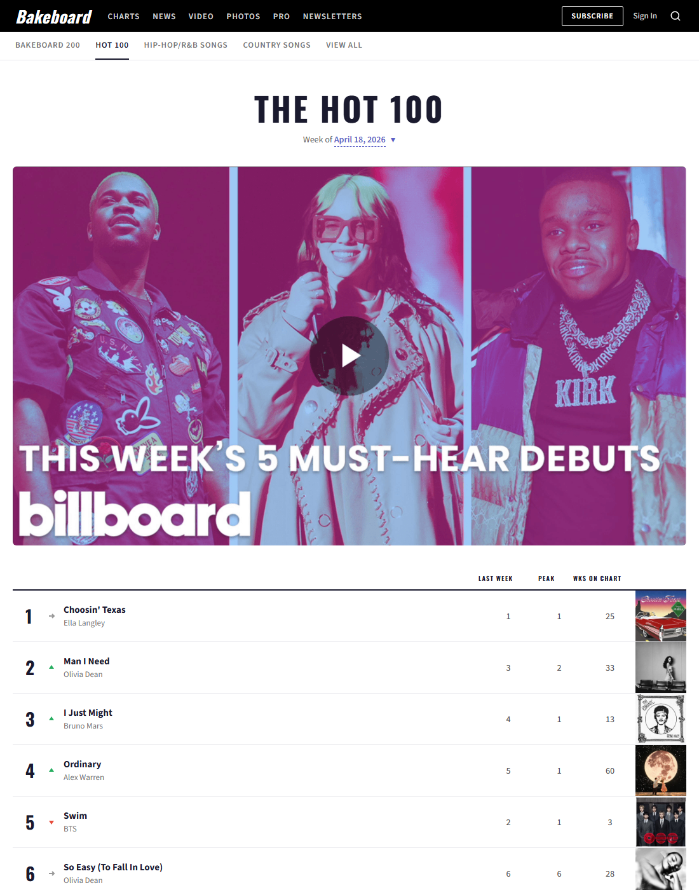
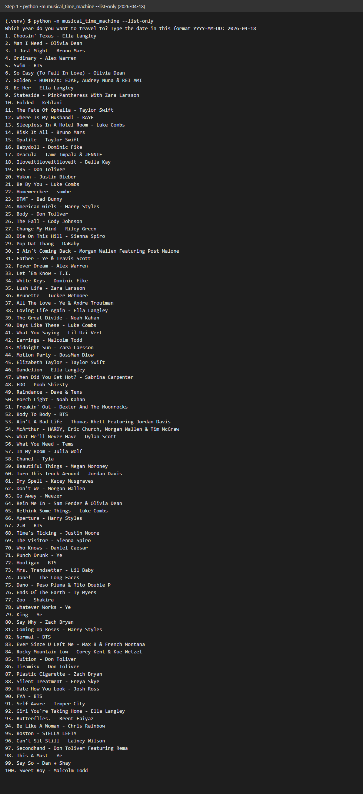
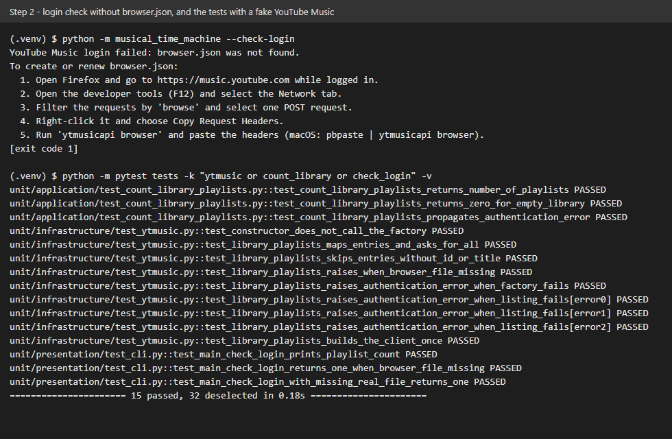
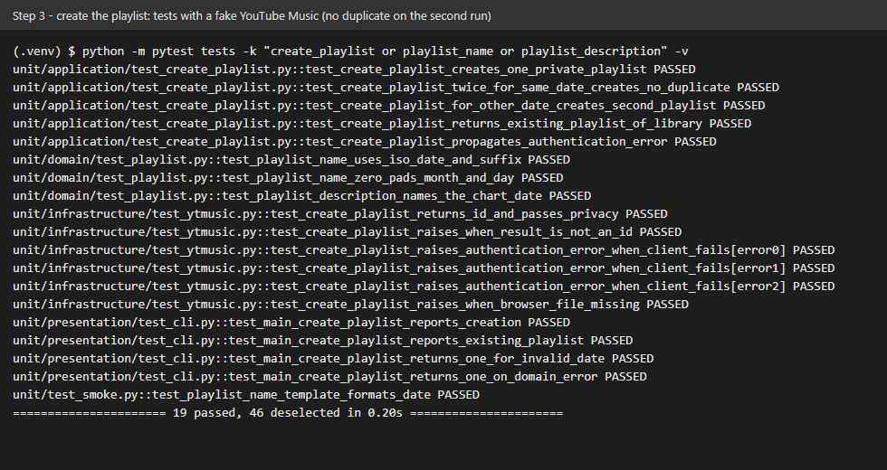
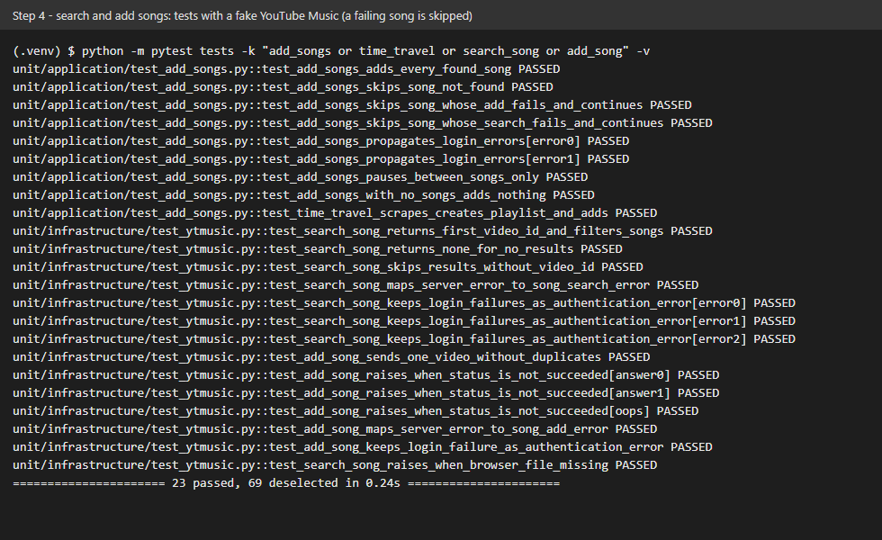

# 🚀 Musical Time Machine

Pick a date, scrape the Billboard Hot 100 of that day and get a private YouTube Music playlist of the songs. A solution to day 46 of Udemy's *100 Days of Code: The Complete Python Pro Bootcamp*, for fellow course participants and anyone browsing for ideas.

## 📚 Table of Contents

- [Overview](#-overview)
- [Requirements](#-requirements)
- [Setup](#-setup)
- [Run](#-run)
- [Tests](#-tests)
- [License](#-license)
- [Links](#-links)
- [Appendix: Project documents](#-appendix-project-documents)

## 🧭 Overview

The program follows the four steps of the lecture:

1. **Scrape the chart.** Ask for a date (`YYYY-MM-DD`) and read the 100 song titles from the Bakeboard clone of the Billboard Hot 100 (`https://appbrewery.github.io/bakeboard-hot-100/`) with `requests` and `BeautifulSoup`.
2. **Authenticate.** Open a YouTube Music session with `ytmusicapi` from a `browser.json` file.
3. **Create the playlist.** Create a private playlist named `{date} Billboard 100`, unless it already exists.
4. **Add the songs.** Search every song and add the top result; a song that fails is skipped.

Layout of the repository:

| Folder | What is in it |
| --- | --- |
| `src/musical_time_machine/` | The program, in the layers `domain`, `application`, `infrastructure` and `presentation`; all constants are in `constants.py` |
| `tests/` | The automated tests (pytest); they use a stored chart page and a fake music service, never the network |
| `docs/` | Business case, plan, milestones, reviews and the wiki sources |

The wiki is written in English, Danish and Bahasa Malaysia and explains what each lecture step teaches.

## 📋 Requirements

- Python 3.13 or later.
- Three runtime libraries, each needed by the assignment: `requests` (fetch the page), `beautifulsoup4` (read the HTML) and `ytmusicapi` (talk to YouTube Music).
- A Google account and Firefox, only for steps 2 to 4 (to create `browser.json`).
- Optional: [Doxygen](https://www.doxygen.nl/) to build the API documentation.

## 🛠️ Setup

Create and use a local virtual environment named `.venv`, then upgrade `pip`:

```bash
python -m venv .venv
```

Activate it (Windows PowerShell):

```powershell
.venv\Scripts\Activate.ps1
```

Activate it (Linux and macOS):

```bash
source .venv/bin/activate
```

```bash
python -m pip install --upgrade pip
python -m pip install -e ".[dev]"
```

Leave out `[dev]` when you only want to run the program.

`browser.json` (steps 2 to 4 only) holds your YouTube Music login cookies. It is ignored by git: never commit it.

1. Open Firefox, go to <https://music.youtube.com> and log in.
2. Open the developer tools (`Ctrl+Shift+I`, on macOS `Cmd+Option+I`), choose the **Network** tab and type `browse` in the filter.
3. Pick a successful `browse?...` request to `music.youtube.com`, right-click it and choose *Copy Value*, then *Copy Request Headers*.
4. In the project folder run `ytmusicapi browser` and paste the headers, then finish with `Ctrl+D` (`Ctrl+Z` and Enter on Windows). On macOS run `pbpaste | ytmusicapi browser`.

The cookies expire after a while; repeat the steps to get a fresh file.

## ▶️ Run

The program is added step by step (one pull request per lecture step):

| Step | Status |
| --- | --- |
| 1. Scrape the Billboard Hot 100 | done (below) |
| 2. YouTube Music authentication | code done; live screenshot waits for `browser.json` |
| 3. Create the playlist | code done; live screenshot waits for `browser.json` |
| 4. Search and add songs | code done; live screenshot waits for `browser.json` |

### Step 1 - Scrape the Billboard Hot 100

```bash
python -m musical_time_machine --list-only
```

The program asks for a date in the format `YYYY-MM-DD` and prints the 100 songs of that chart as `rank. title - artist`. Use a date that Bakeboard has, for example `2026-04-18`. `scrape_titles` returns the titles as a Python list; a date in the wrong format or a chart that does not exist ends the program with a clear message.

The chart page on Bakeboard:



The program's output for the same date (rendered from the real output of the run, not a photo of a terminal window):



### Step 2 - YouTube Music authentication

Create `browser.json` as described in [Setup](#-setup), then check the login:

```bash
python -m musical_time_machine --check-login
```

It prints `Found N playlists in your library.`. With no or an expired `browser.json` it prints the renewal steps and exits with code 1 instead of a stack trace. `--browser-file PATH` uses another file.

The screenshot below shows the run **without** a `browser.json` and the tests that use a fake YouTube Music service. A screenshot of a live login is added once the file exists (issue 22 stays open until then); the file holds personal cookies and is never committed.



### Step 3 - Create the playlist

```bash
python -m musical_time_machine --create-playlist
```

It asks for the date and creates the private playlist `YYYY-MM-DD Billboard 100` in your YouTube Music library. It first looks through `get_library_playlists()` for a playlist with the same title, so a second run for the same date creates nothing and says so.

The screenshot shows the tests of this step, which use a fake YouTube Music service (no account needed). A screenshot of the live playlist is added once `browser.json` exists (issue 27 stays open until then).



### Step 4 - Search and add songs

```bash
python -m musical_time_machine
```

The full program: it asks for the date, scrapes the chart, creates the playlist (or reuses the existing one), then searches YouTube Music for each song (`yt.search(..., filter="songs")`) and adds the top result with `yt.add_playlist_items()`. A song that is not found or fails is skipped and the run goes on; the summary says how many songs were added and which were skipped. A failed login stops the run, because every following song would fail too. Use `--list-only` to print the chart without logging in (step 1).

The screenshot shows the tests of this step with a fake YouTube Music service. A screenshot of the live playlist is added once `browser.json` exists (issue 34 stays open until then).



## 🧪 Tests

```bash
python -m pytest
```

To build the API documentation (written as Doxygen comments in the source):

```bash
doxygen Doxyfile
```

## 📄 License

GNU Affero General Public License v3.0, see [LICENSE](./LICENSE).

## 🔗 Links

- [Repository][repository]
- [Documentation][documentation]
- [Issue tracker][issues]

## 📎 Appendix: Project documents

| Document | What it tells you |
| --- | --- |
| [AGENTS.md][agents] | The rules AI agents follow in this repository |
| [Business Case][BC-001] | Why the project exists, its scope and success criteria |
| [Stakeholder Analysis][SA-001] | Who is involved; the stakeholder IDs used for owners and reviewers |
| [Project Plan][PP-001] | The gateways and their schedule |
| [Milestones][milestones] | One document per gateway: Go/No-Go criteria and tasks |
| [Artifact registry][registry] | Where each artifact type lives, the next version, the PO language and domain |
| [Traceability matrix][TM-001] | How the artifacts link and when each was last reviewed |
| [Governance][GOV-001] | The review workflow, who decides and how disputes escalate |
| [Framework README][framework-readme] | The framework this project uses |
| [Framework changelog][framework-changelog] | What changed in each framework release |

---

[repository]: https://git.tirsystem.com/Tirsvad-Udemy-100-days-of-code/046-scraping-the-billboard
[documentation]: https://git.tirsystem.com/Tirsvad-Udemy-100-days-of-code/046-scraping-the-billboard/wiki
[issues]: https://git.tirsystem.com/Tirsvad-Udemy-100-days-of-code/046-scraping-the-billboard/issues
[agents]: ./AGENTS.md
[BC-001]: ./docs/business-case.md
[SA-001]: ./docs/stakeholder-analysis.md
[PP-001]: ./docs/project-plan.md
[milestones]: ./docs/milestones/
[registry]: ./docs/artifact-registry.md
[TM-001]: ./docs/sqa/traceability-matrix.md
[GOV-001]: ./docs/sqa/governance.md
[framework-readme]: ./framework/README.md
[framework-changelog]: ./framework/CHANGELOG.md
