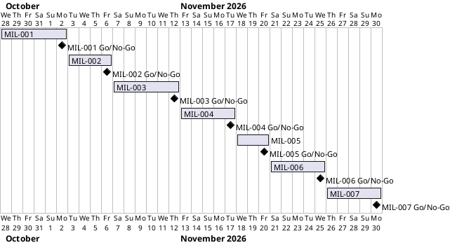

# Project Plan

## Metadata
| Key | Value |
| --- | --- |
| ID | PP-001 |
| CrossReference | [BC-001], [SA-001], [MIL-001], [MIL-002], [MIL-003], [MIL-004], [MIL-005], [MIL-006], [MIL-007] |
| Language | en |
| Domain | it |

## Version History
| Date | Status | Author | Reviewer | Change | Commit |
| --- | --- | --- | --- | --- | --- |
| 2026-10-28 | Accepted | Jens Tirsvad Nielsen | AI as stand-in for S01 | Initial version | [01e016e] |

---

## Purpose

This plan schedules the seven milestones of the Musical Time Machine project inside the Business Case window of 2026-10-28 to 2026-11-30 ([BC-001], Constraints).

## Planning Assumptions

- Week 1 starts 2026-10-28; the plan ends by 2026-11-30, per the Business Case constraint.
- One milestone is one branch and one pull request; a milestone is as long as its tasks need, between 4 and 9 days.
- Reviews are done by the AI as stand-in for S01 ([SA-001], S01); the language criteria of `QC-LANG-001` that need a person stay open until S01 confirms them.
- Live steps 2 to 4 need S01's `browser.json`; the dates of MIL-004 to MIL-006 assume it exists by 2026-11-14.

## Gateway Schedule

| Gateway | Document | Window | Decision date | Owner | Stories | Main deliverable | Milestone |
| --- | --- | --- | --- | --- | --- | --- | --- |
| Planning baseline | [MIL-001] | 2026-10-28 to 2026-11-02 | 2026-11-02 | S01 | none (technical tasks) | Accepted `BC-001` | [Milestone 1](https://git.tirsystem.com/Tirsvad-Udemy-100-days-of-code/046-scraping-the-billboard/milestones/264) |
| Project scaffold | [MIL-002] | 2026-11-03 to 2026-11-06 | 2026-11-06 | S01 | none (technical tasks) | A project skeleton with `pyproject | [Milestone 2](https://git.tirsystem.com/Tirsvad-Udemy-100-days-of-code/046-scraping-the-billboard/milestones/265) |
| Step 1 - Scrape the Billboard Hot 100 | [MIL-003] | 2026-11-07 to 2026-11-12 | 2026-11-12 | S01 | none (technical tasks) | A command that asks for a date in YYYY-MM-DD format | [Milestone 3](https://git.tirsystem.com/Tirsvad-Udemy-100-days-of-code/046-scraping-the-billboard/milestones/266) |
| Step 2 - YouTube Music authentication | [MIL-004] | 2026-11-13 to 2026-11-17 | 2026-11-17 | S01 | none (technical tasks) | A client adapter around `ytmusicapi` that reads `browser | [Milestone 4](https://git.tirsystem.com/Tirsvad-Udemy-100-days-of-code/046-scraping-the-billboard/milestones/267) |
| Step 3 - Create the playlist | [MIL-005] | 2026-11-18 to 2026-11-20 | 2026-11-20 | S01 | none (technical tasks) | A `create_playlist` use case that returns the id of an existing or new private playlist | [Milestone 5](https://git.tirsystem.com/Tirsvad-Udemy-100-days-of-code/046-scraping-the-billboard/milestones/268) |
| Step 4 - Search and add songs | [MIL-006] | 2026-11-21 to 2026-11-25 | 2026-11-25 | S01 | none (technical tasks) | An `add_songs` use case that searches with the song filter and adds the top result | [Milestone 6](https://git.tirsystem.com/Tirsvad-Udemy-100-days-of-code/046-scraping-the-billboard/milestones/269) |
| Wiki and release | [MIL-007] | 2026-11-26 to 2026-11-30 | 2026-11-30 | S01 | none (technical tasks) | Wiki pages in `docs/wiki/` in English | [Milestone 7](https://git.tirsystem.com/Tirsvad-Udemy-100-days-of-code/046-scraping-the-billboard/milestones/270) |



## Scope Coverage

| Business Case scope item | Gateway |
| --- | --- |
| Repository description and topics | [MIL-001] |
| `pyproject.toml`, `.venv` instructions, `constants.py`, Doxygen, README from the template, `.gitignore` | [MIL-002] |
| Scraping of Bakeboard into a list (O1) | [MIL-003] |
| YouTube Music authentication (O2) | [MIL-004] |
| Playlist creation without duplicates (O3) | [MIL-005] |
| Search and add songs (O4) | [MIL-006] |
| Wiki in en, da, ms and the step screenshots (O5) | [MIL-003] to [MIL-007] |

## Dependencies

```
MIL-001 → MIL-002 → MIL-003 → MIL-004 → MIL-005 → MIL-006 → MIL-007
```

A No-Go on a gateway returns it to rework and moves every later date by the rework time; the end date 2026-11-30 moves only if S01 decides so in chat.

## Plan Risks

| Risk | Impact | Mitigation |
| --- | --- | --- |
| `browser.json` not available by 2026-11-14 | MIL-004 to MIL-006 cannot be closed | The run stops and reports; tests with fakes are finished so only the live screenshots wait |
| Language criteria need a person | Baseline stays `Go-with-conditions` | Ask S01 to confirm criteria 3, 5 and 9 of `QC-LANG-001` when accepting the plan |
| Bakeboard offline during the live run | Step 1 screenshot delayed | The stored fixture proves the code; the screenshot is taken later |

## Open Issues

- The owner of the repository on the git host: the `origin` remote uses `Tirsvad-Udemy-100-days-of-code`, the request names `Tirsvad-Udemy-100_days_of_code`; the remote is used until S01 says otherwise.
- Whether the live steps 2 to 4 can be run depends on `browser.json` from S01.

---

[BC-001]: ./business-case.md
[SA-001]: ./stakeholder-analysis.md
[MIL-001]: ./milestones/mil-001-planning-baseline.md
[MIL-002]: ./milestones/mil-002-project-scaffold.md
[MIL-003]: ./milestones/mil-003-step-1-scrape-billboard.md
[MIL-004]: ./milestones/mil-004-step-2-youtube-music-auth.md
[MIL-005]: ./milestones/mil-005-step-3-create-playlist.md
[MIL-006]: ./milestones/mil-006-step-4-search-and-add-songs.md
[MIL-007]: ./milestones/mil-007-wiki-and-release.md
[01e016e]: https://git.tirsystem.com/Tirsvad-Udemy-100-days-of-code/046-scraping-the-billboard/commit/01e016e15dd93cface4f4ae9e9e99919e0aace2b
